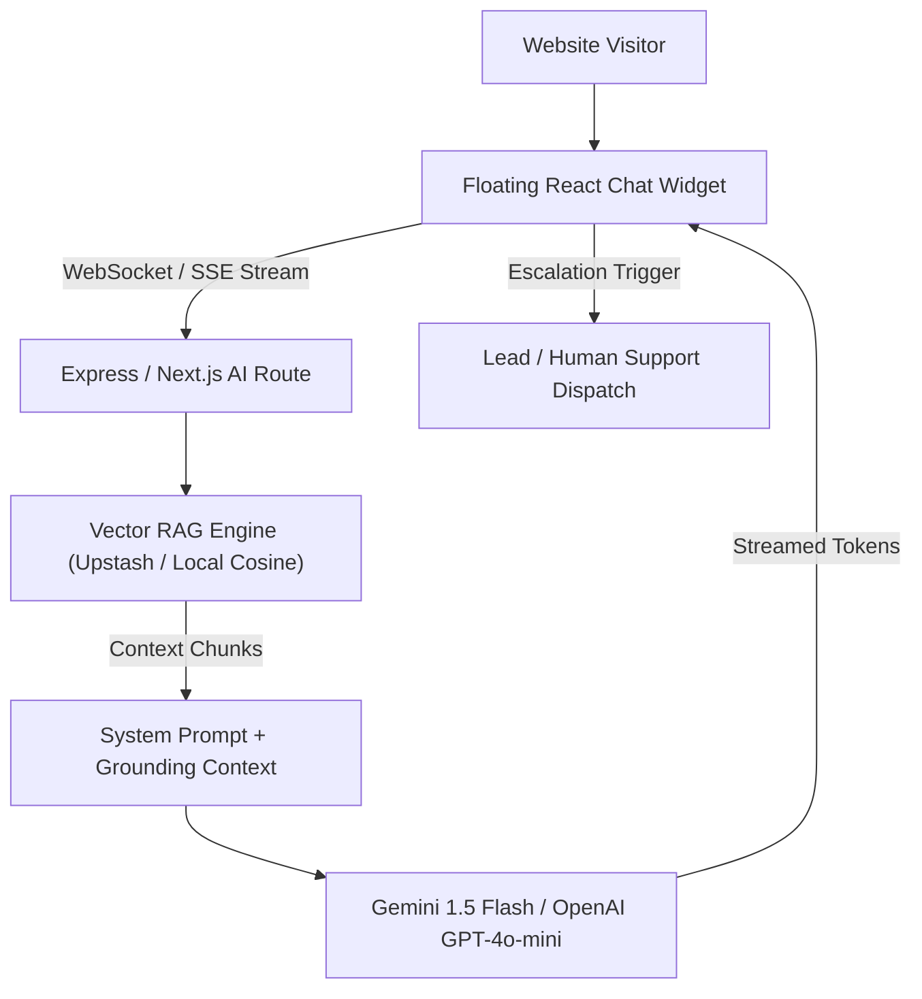

# Gig 6: Custom AI Chatbots & 24/7 Customer Support Agents

> **Brand:** FrameForge (`@frameforgehq`)  
> **Category:** Programming & Tech > AI Development > AI Chatbot Development / AI Agents  
> **Target Rate:** \$80 – \$450+ per client order  

---

## 1. Fiverr Marketplace Strategy & Positioning

Custom AI chatbots and automated customer support agents represent the single fastest-growing, highest-margin category on Fiverr. While standard web development has high competition, specialized **RAG (Retrieval-Augmented Generation) customer support agents trained on business data** are in hyper-demand from:
- **E-commerce brands:** Answering shipping, returns, order status, and sizing questions.
- **SaaS companies:** Explaining technical documentation, onboarding users, and triaging support tickets.
- **Service businesses / Real Estate:** 24/7 lead qualification, answering FAQs, and booking meetings automatically.

### Fiverr Gig Metadata
- **Gig Title:** *I will build a custom AI chatbot or customer support agent for your website*
- **Alternative Title:** *I will build an AI customer support chatbot with OpenAI and custom data*
- **Primary Search Tags:** `ai chatbot`, `customer support agent`, `website chatbot`, `rag chatbot`, `openai chatbot`
- **Secondary Tags:** `gemini api`, `ai agent`, `custom chatbot`, `chat widget`

---

## 2. 3-Tier Fiverr Pricing & Package Matrix

| Feature | Basic – "AI Chat Widget" (\$80 / 3 Days) | Standard – "Smart RAG Support Agent" (\$220 / 6 Days) | Premium – "Full Autonomous Support Hub" (\$450 / 10 Days) |
| :--- | :--- | :--- | :--- |
| **Ideal For** | Simple website FAQ answering & lead capture | Businesses with knowledge bases, PDFs, or docs | High-volume SaaS, E-commerce, multi-channel |
| **Model Integration** | Gemini 1.5 Flash or OpenAI GPT-4o-mini | OpenAI / Gemini with Streaming Responses | Multi-provider streaming + Fallback routing |
| **Knowledge Base (RAG)** | Pre-prompted business context & static FAQs | Vector Search on PDFs / URLs / Notion docs | Dynamic multi-doc vector indexing + real-time updates |
| **UI Component** | Floating React / Tailwind chat bubble | Modern glassmorphic chat widget (Light/Dark) | Brand-customized widget + Admin conversation dashboard |
| **Streaming UI** | Typing indicator | Token-by-token typewriter streaming | Token streaming + Markdown & code formatting |
| **Lead Capture & Actions**| Basic email capture form | Automated lead qualification & email alert | Calendly booking + Webhook sync (Zapier/Make/Slack) |
| **Human Escalation** | ❌ None | Email notification to human support team | Live agent takeover mode / Zendesk ticket creation |
| **Revisions** | 2 Revisions | 4 Revisions | Unlimited Revisions |

---

## 3. The 5-Project Portfolio Matrix for Gig 6

| # | Project Name | Target Vertical | Key Capabilities | Tech Stack |
|---|---|---|---|---|
| **6.1** | **SupportForge AI** *(Flagship)* | SaaS & Customer Service | Embeddable floating chat widget, markdown streaming, company FAQ vector RAG, human ticket escalation | React, Tailwind, Gemini/OpenAI API, Vector Search |
| **6.2** | **LeadGenBot AI** | B2B Agencies & Realtors | Conversational sales qualifier, Calendly meeting booking, lead scoring, Zapier/webhook sync | React, Node.js, LangChain, Calendly Embed, Tailwind |
| **6.3** | **DocuQuery AI** | Legal, Medical, Research | Multi-file PDF/DOCX upload, chunked vector search, exact page citations, chat history export | React, Express, Vector Embeddings, Multer, Tailwind |
| **6.4** | **OmniDesk AI** | Retail & Multi-channel | Unified web chat + WhatsApp/Telegram webhook routing, human agent live takeover console | React, Node, Socket.io, Twilio API, MongoDB |
| **6.5** | **ShopAssist AI** | E-commerce / Shopify | Natural language product search, budget filters, order tracking lookup, direct cart links | React, Tailwind, Node, Product Catalog API, Function Calling |

---

## 4. Flagship Blueprint: SupportForge AI (Project 6.1)

### Architecture Diagram

### Key Technical Deliverables for Demo
1. **Interactive Floating Bubble:** Floats in bottom-right corner, toggles open smoothly with sound & badge alert.
2. **Streaming Response Engine:** Token-by-token real-time streaming with zero perceived lag.
3. **Knowledge Base Switcher:** Allows prospective clients to switch between 3 sample industries (SaaS, Real Estate, E-Commerce) to test how it answers specific questions accurately without hallucinating.
4. **Lead Capture & Human Fallback:** Form that collects user email and issue summary when user clicks "Talk to Human".
5. **One-Line Embed Code:** Generates `` preview showing clients how easily it integrates into their website.
